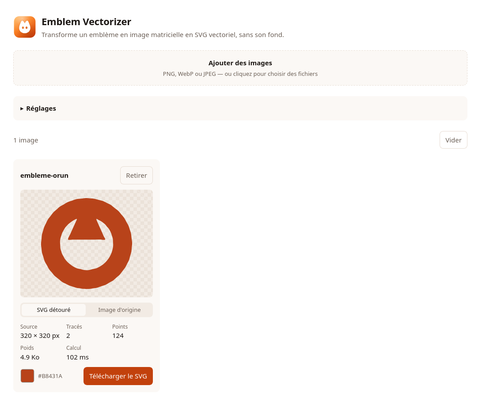
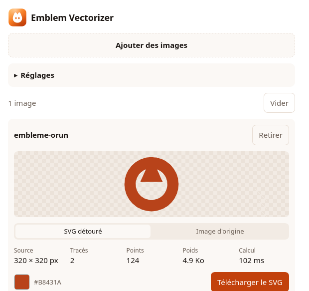

<div align="center">


# Blason

<p><strong>Un emblème posé sur fond blanc, un SVG détouré, prêt à l'emploi.</strong></p>
<p>Tout le calcul se fait sur votre machine. Aucune image n'est envoyée sur un serveur.</p>

<p>


</p>

<p>


</p>



</div>

## Le projet

Un logo scanné, exporté d'une planche ou récupéré en PNG reste une image matricielle :
il bave dès qu'on l'agrandit, et son fond blanc se voit sur toute surface qui ne l'est
pas. Le redessiner à la main dans un éditeur vectoriel prend une heure par emblème.

Blason fait ce passage automatiquement. Vous déposez des PNG, WebP ou JPEG,
il en sort des SVG qui ne contiennent qu'un tracé rempli, sans fond : ils se posent sur
n'importe quelle couleur, s'impriment à n'importe quelle taille et pèsent quelques
kilo-octets.

Le projet est né d'un script Python jetable qui découpait une planche de quatorze
emblèmes à des coordonnées écrites en dur. Il en reste l'idée ; le traitement a été
réécrit, corrigé et mesuré. Le script d'origine est conservé dans
[`legacy/`](legacy/README.md).

## Deux conditions pour un bon résultat

1. **Fond parfaitement blanc**, sans ombre portée ni dégradé. Ce qui n'est pas blanc est
   considéré comme faisant partie de l'emblème.
2. **Couleur franche et bien visible.** Un emblème presque blanc est confondu avec le
   fond ; le seuil de détection peut être abaissé, mais le résultat restera incertain.

Le logiciel vérifie ces deux points sur chaque image et le dit clairement quand ils ne
sont pas réunis, plutôt que de rendre un fichier décevant sans explication.

## Les technologies, et pourquoi

| Brique | Choix | Raison |
| --- | --- | --- |
| Traitement d'image | TypeScript, **aucune bibliothèque** | Le pipeline est écrit à la main, sans OpenCV ni WASM à embarquer. Il ne touche jamais au DOM, donc le même code tourne dans le navigateur, dans un worker, dans Node sous test et dans la webview du logiciel de bureau. |
| Calcul | **Web Worker** | Une grande image ne doit pas figer l'interface. Le worker garde les pixels : régler un curseur n'envoie que les réglages. |
| Interface | **React 18** et **Vite 5** | Peu d'état, beaucoup de rendu : React suffit. Vite donne un démarrage immédiat et un paquet de 51 Ko compressé. |
| Types | **TypeScript 5.6**, mode strict | Les tableaux de pixels et les systèmes de coordonnées sont l'endroit idéal pour se tromper d'une unité. |
| Bureau | **Tauri 2** et **Rust 1.77** | La webview du système au lieu d'un Chromium embarqué : 1,6 Mo de paquet Linux, là où un équivalent Electron se compte en centaines de méga-octets. Rust n'ouvre que la fenêtre et enregistre le fichier. |
| Tests | `node:test`, sans dépendance | Les tests vérifient de la géométrie, pas des composants : ils n'ont besoin d'aucun navigateur. |

## Démarrer

```bash
npm install
npm run dev      # http://localhost:5173
```

| Commande | Rôle |
| --- | --- |
| `npm run dev` | Serveur de développement |
| `npm run build` | Vérifie les types puis produit le site statique dans `dist/` |
| `npm run preview` | Sert le résultat de `build` |
| `npm test` | Types, puis la suite de tests du cœur de traitement |
| `npm run vectorize -- image.png sortie.svg` | Vectorise un fichier en ligne de commande |
| `npm run tauri dev` / `npm run tauri build` | Version bureau, voir [`docs/desktop.md`](docs/desktop.md) |
| `npm run tauri icon public/logo.svg` | Régénère toutes les icônes depuis le logo |

## Utiliser

Déposez une ou plusieurs images, puis téléchargez les SVG. Chaque carte montre le tracé
obtenu sur un damier, qui rend le fond manquant visible, et donne le nombre de tracés,
de points et le poids du fichier.

La couleur est détectée sur l'image. Le sélecteur permet de la remplacer, par exemple
pour décliner un même emblème en plusieurs teintes.

### Réglages

| Réglage | Effet |
| --- | --- |
| Seuil de détection | Ce qui compte comme emblème. À baisser pour une teinte claire, à monter si le papier scanné est grisé. |
| Finesse du tracé | Suréchantillonnage avant le tracé des contours. 3 suffit presque toujours. |
| Lissage | Adoucit l'escalier des pixels. Trop fort, les angles s'arrondissent. |
| Simplification | Arbitre entre le poids du fichier et la fidélité au pixel. |
| Formes ignorées | Surface en dessous de laquelle une tache est tenue pour une poussière. |
| Marge | Espace blanc laissé autour de l'emblème dans le SVG. |

## Comment ça marche

L'image devient un champ d'encre, c'est-à-dire la distance au blanc de chaque pixel.
Ce champ est suréchantillonné, lissé, puis binarisé à mi-chemin entre le seuil de
détection et l'intensité réelle de l'emblème, ce qui place le contour sur le bord perçu
au lieu de le dilater. Les contours de ce masque sont suivis sur le réseau des coins de
pixels, simplifiés par Ramer-Douglas-Peucker, puis transformés en courbes de Bézier
cubiques par une spline Catmull-Rom centripète. Le SVG final contient un seul tracé en
`fill-rule="evenodd"` : les trous se découpent tout seuls.

Le détail des sept étapes et des choix est dans
[`docs/architecture.md`](docs/architecture.md).

## Fiabilité

La suite de tests vectorise des formes connues (carré, disque, anneau, forme fine),
**re-rasterise le SVG produit** avec son propre moteur de remplissage et le compare
pixel par pixel à l'image de départ. La fidélité mesurée va de 0,986 à 0,996
d'intersection sur union. Un fichier bien formé qui ne suit pas la forme passerait tous
les autres tests et échouerait sur celui-là.

```bash
npm test
```

Pour vérifier la chaîne complète dans un vrai navigateur, décodage et worker compris,
lancez `npm run dev` puis ouvrez `/dev/selftest.html`.

## Version bureau

Le logiciel s'installe sur Linux, Windows et macOS. Un paquet ne se fabrique que sur le
système qu'il vise, d'où le workflow GitHub Actions qui compile sur quatre machines.

| Système | Formats | Taille |
| --- | --- | --- |
| Linux | `.deb`, `.AppImage` | 1,7 Mo et 80 Mo |
| Windows | `.exe` (NSIS), `.msi` | 1,4 Mo |
| macOS | `.app`, `.dmg` | environ 10 Mo |

La fenêtre s'ouvre centrée, petite et carrée : 620 par 620, redimensionnable, rien à
faire défiler pour atteindre le bouton de téléchargement.



Prérequis, compilation locale, compilation croisée et signature :
[`docs/desktop.md`](docs/desktop.md).

## Identité


Le logo tient dans un seul fichier, [`public/logo.svg`](public/logo.svg) : un écusson
blanc aux yeux évidés sur un carré arrondi en dégradé d'orange chaleureux. Il sert
d'icône d'application, de favicon et de marque dans l'en-tête, et c'est la source de
toutes les icônes de plateforme.

L'interface est en mode clair uniquement, sur fond blanc. Toute sa couleur tient dans
une dizaine de variables CSS en haut de `src/styles/app.css`.

| Usage | Valeur |
| --- | --- |
| Fond de page | `#FFFFFF` |
| Panneaux et cartes | `#FBF8F5` |
| Accent, boutons, focus | `#C2410C` |
| Texte | `#1C1714`, et `#6B5F56` en atténué |
| Dégradé du logo | `#FFB45E` vers `#F97E22` vers `#D2400A` |

## Structure

```
public/logo.svg   la marque, source unique des icônes
src/
  core/           traitement d'image pur, sans DOM, testable dans Node
  platform/       décodage des fichiers, worker, enregistrement web ou bureau
  workers/        le worker de vectorisation et son protocole
  components/     interface React
  hooks/          état de l'application
  styles/         les variables de couleur et la mise en page
src-tauri/        coque bureau en Rust, et les icônes
tests/            géométrie, fidélité, tangentes des courbes
scripts/          vectorisation en ligne de commande
dev/              auto-test navigateur
docs/             architecture et guide bureau
legacy/           le script Python d'origine, conservé pour mémoire
.github/          compilation des paquets Linux, Windows et macOS
```

## Licence

Usage interne.
