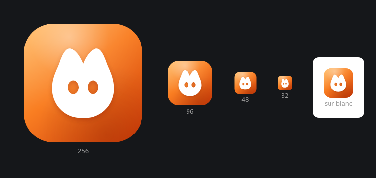

# Identité



Le logo tient dans un seul fichier, [`public/logo.svg`](../public/logo.svg) : un écusson
blanc aux yeux évidés sur un carré arrondi en dégradé d'orange chaleureux. Il sert
d'icône d'application, de favicon et de marque dans l'en-tête, et c'est la source de
toutes les icônes de plateforme.

```bash
npm run tauri icon public/logo.svg   # régénère toutes les icônes depuis le logo
```

## Couleurs

L'interface est en mode clair uniquement, sur fond blanc. Toute sa couleur tient dans
une dizaine de variables CSS en haut de `src/styles/app.css`.

| Usage | Valeur |
| --- | --- |
| Fond de page | `#FFFFFF` |
| Panneaux et cartes | `#FBF8F5` |
| Accent, boutons, focus | `#C2410C` |
| Texte | `#1C1714`, et `#6B5F56` en atténué |
| Dégradé du logo | `#FFB45E` vers `#F97E22` vers `#D2400A` |
