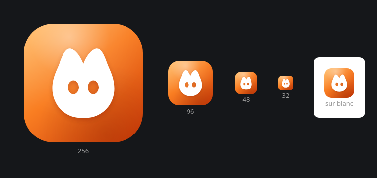

# Identity



The logo fits in a single file, [`public/logo.svg`](../public/logo.svg): a white shield
with hollowed-out eyes on a rounded square in a warm orange gradient. It serves as the
application icon, the favicon and the mark in the header, and it is the source of every
platform icon.

```bash
npm run tauri icon public/logo.svg   # regenerates every icon from the logo
```

## Colors

The interface is light mode only, on a white background. All of its color lives in a
dozen CSS variables at the top of `src/styles/app.css`.

| Use | Value |
| --- | --- |
| Page background | `#FFFFFF` |
| Panels and cards | `#FBF8F5` |
| Accent, buttons, focus | `#C2410C` |
| Text | `#1C1714`, and `#6B5F56` when muted |
| Logo gradient | `#FFB45E` to `#F97E22` to `#D2400A` |
